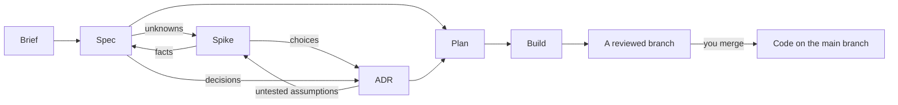

# Skills for Agentic Engineering

Skills for building software with coding agents, with engineering rigour. This is agentic
engineering in the sense of engineering software with an agent, not of building agent systems.

The skills are a plugin for [Claude Code](https://code.claude.com/docs), Anthropic's coding
assistant, run as `/agentic:<name>` commands. Together they take each piece of work from an idea
to reviewed, working code along one defined path, and keep what was decided, and why, in a few
short Markdown documents in your repository.

Every document Claude writes is checked by an independent reviewer before you see it, and no
document moves forward until you sign it off. The result is a project whose intent, decisions and
built work can be read from its documents, not lost in old conversations.

## Requirements

- Claude Code, tested on Opus 5.5. Other models may work but are untested.
- Python 3.7 or later, which the plugin's checks run on. On Python 3.6, the plugin warns you
  when a session starts.
- Git, with a remote named `origin`, for [`/build`](docs/skills/build.md), which pushes the branch
  it builds.

## Install

In Claude Code:

```
/plugin marketplace add michaelmarconi/marketplace
/plugin install agentic@michaelmarconi
```

Or from a terminal:

```bash
claude plugin marketplace add michaelmarconi/marketplace
claude plugin install agentic@michaelmarconi
```

Install the plugin before you start the session you will use it in: a plugin installed partway
through a session only loads in the next one.

Add `--scope project` to the `install` command to install the plugin for everyone working in a
repository. This records it in the repository's `.claude/settings.json`.

## Quick start

In your repository, run the skills in order. Each one drafts a document with you, has it
reviewed, corrects it and shows you the result to sign off. Where your Claude app can show a file
beside the conversation, the document opens there, and you can select lines in it to comment on;
anywhere else Claude names the file's path.

1. `/agentic:brief` writes the product brief: what the product is, who it is for and why.
2. `/agentic:spec` writes the spec for one capability: what it should do, and how you will know it
   does.
3. `/agentic:spike` settles any unknown the spec or a decision can't settle without trying
   something, with a throwaway experiment. Skip it when nothing is unknown.
4. `/agentic:adr` records any technical decision the spec needs.
5. `/agentic:plan` plans a piece of work against the spec and its decisions.
6. `/agentic:build` builds the plan on a branch, tests first, and has the result reviewed. Start it
   in a fresh session, or after `/clear`.

You can also ask in your own words, such as "write a spec for invoice reminders". Claude picks
the matching skill.

## How it works

The lifecycle keeps five kinds of document:

| Document | Where | What it holds |
|---|---|---|
| Brief | `docs/brief.md` | What the product is, who it is for and why. One per product. |
| Spec | `docs/specs/` | What one capability should do, and how we will know it does. |
| ADR (architecture decision record) | `docs/adrs/` | One technical decision and why it was made, written to read plain first. |
| Plan | `docs/plans/` | One piece of work that builds part of a spec or an ADR. It is temporary: frozen once built, and deleted whenever nobody needs it. |
| Spike record | `docs/spikes/` | One hypothesis tested by a throwaway experiment: the experiment, what it produced and the finding, written to read plain first. |

Each document except the brief has a status, such as `📝 Draft` or `🟢 Ready to build`. A
project can also record its **practices**, such as how it is built, tested and released, in
`AGENTS.md` and `docs/practices/`, for Claude and other coding tools to follow.

The plugin works through three parts:

- **Skills:** the steps above, each run as a `/agentic:<name>` command.
- **Reviewer agents:** separate Claude instances that check each document, each build, or, for
  `/agentic:audit`, the code against each document, with no memory of your conversation, so the
  conversation cannot sway their judgement. They always run on Sonnet, so the same document gets
  the same judgement whatever model you use.
- **Hooks:** small checks Claude Code runs automatically. They give Claude the lifecycle rules at
  the start of every session in a repository that has a brief or a spec, and refuse any status
  change the lifecycle does not allow.

[The lifecycle rules](docs/lifecycle.md) describe all of it in full. Read them before you edit
documents by hand.

## Skills

| Skill | What it does |
|---|---|
| [`/agentic:brief`](docs/skills/brief.md) | Writes or changes the product brief |
| [`/agentic:spec`](docs/skills/spec.md) | Writes or changes the spec for one capability |
| [`/agentic:spike`](docs/skills/spike.md) | Settles one unknown with a throwaway experiment |
| [`/agentic:adr`](docs/skills/adr.md) | Records one technical decision |
| [`/agentic:plan`](docs/skills/plan.md) | Plans a piece of work against its specs and ADRs |
| [`/agentic:build`](docs/skills/build.md) | Builds a plan on a branch, has it reviewed and hands it back |
| [`/agentic:practices`](docs/skills/practices.md) | Records how the project does things, one topic at a time |
| [`/agentic:audit`](docs/skills/audit.md) | Finds where the code and its documents no longer agree, and where a spec or ADR contradicts the brief, and changes nothing |
| [`/agentic:feedback`](docs/skills/feedback.md) | Drafts a GitHub issue about the plugin itself |



## What it changes in your repository

- It writes only the documents above, and the practices you ask it to record, and only when you
  run a skill or ask for one.
- `/agentic:build` commits to a branch of its own and pushes it. It never commits to the main
  branch, never opens a pull request and never merges: those steps stay with you.
- Review reports, and the report files `/agentic:build` and `/agentic:audit` end with, are kept in the
  plugin's own data folder, outside your repository.
- Nothing else is added, unless you install the plugin with `--scope project`.

## Update

```bash
claude plugin marketplace update michaelmarconi
claude plugin update agentic@michaelmarconi
```

To update automatically, run `/plugin`, open **Marketplaces**, select `michaelmarconi` and choose
**Enable auto-update**. New versions load in the next session, or after `/reload-plugins`.

Read [CHANGELOG.md](CHANGELOG.md) before you update. If a version needs changes to your
documents, its entry says what they are.

### If you installed it as `sdlc@sdlc`

The plugin was called `sdlc` and listed in this repository's own catalog. That catalog still
works, and moves your install to the new name:

1. Finish any review, build or spike in progress first: the plugin's saved records of them are
   kept under the old name and are not carried over.
2. Run `claude plugin marketplace update sdlc`. This rewrites `sdlc@sdlc` to `agentic@sdlc` in
   your settings, including a repository's `.claude/settings.json`, which you then commit.
3. Run `claude plugin install agentic@sdlc`, adding `--scope project` if you installed it that
   way, so the install record matches.
4. Use `/agentic:<name>` from now on, and change any notes or scheduled commands that use the
   old `sdlc` prefix.

When convenient, move to the new catalog, again with no review, build or spike in progress, since
the saved records move to a new folder once more:

1. Run `claude plugin marketplace remove sdlc`. This also takes `agentic@sdlc` out of your
   settings, including a repository's `.claude/settings.json`.
2. Install as above, adding `--scope project` if you installed it that way, and commit the
   settings change.

Never enable both `agentic@sdlc` and `agentic@michaelmarconi`: with two plugins of the same name,
Claude Code drops one copy's hooks. Your documents need no change.

## Feedback

Run `/agentic:feedback` to report a bug or suggest an improvement. It drafts a GitHub issue that
quotes nothing from your repository, shows it to you, and files it only when you agree. You can
also [open an issue](https://github.com/michaelmarconi/agentic-engineering/issues) directly.

## Contributing

Feedback comes in through `/agentic:feedback` or an issue; pull requests are not accepted from
outside the project. [CONTRIBUTING.md](CONTRIBUTING.md) says why, and where the rules for
working on the plugin live.

## Licence

Released under the [MIT licence](LICENSE).
