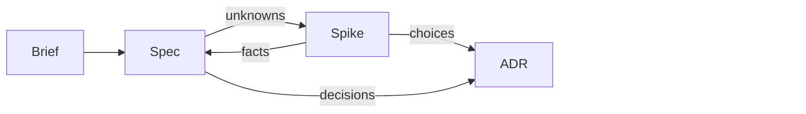
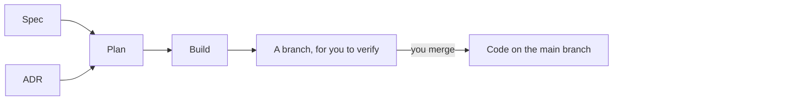
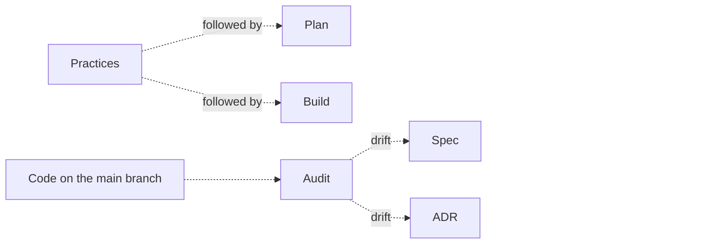
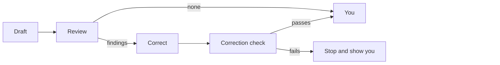

# The lifecycle rules

This page holds the whole lifecycle: the documents it keeps, the steps that write them, the
principles they follow, the words they use and how every document is reviewed. The plugin gives this page to Claude
at the start of every session in a repository that has a brief or a spec, so Claude knows how the
steps fit together even when you run only one of them. The [README](../README.md) introduces the
plugin and how to install it.

## Documents

The lifecycle keeps its thinking in five kinds of document, each a Markdown file in your
repository. Every document except the brief has a status, the `status:` field in its frontmatter,
which says how far along it is.

- **Brief**, `docs/brief.md`: what the product is, who it is for and why. One per product,
  holding only what is true of the whole product. No status; it is never built, only kept true,
  and edited in place.
- **Spec**, `docs/specs/**/<capability>.spec.md`: what one capability of the product should do,
  and how we will know it does. A product has many. Statuses: `📝 Draft` → `👍 Accepted`; any change returns it
  to `📝 Draft`. The status describes the document, not the software: whether the software meets
  a spec is found by checking the software against it.
- **ADR** (architecture decision record), `docs/adrs/NNNN-<subject>.md`, in one flat folder: one
  technical decision and why it was made. Statuses: `📝 Draft` → `👍 Accepted` or
  `❌ Rejected`; `👍 Accepted` → `↪️ Superseded`.
- **Plan**, `docs/plans/YYYY-MM-DD-<title>.md`, in one flat folder: a piece of work that builds
  part of a spec or an ADR. Statuses: `📝 Draft` → `🟢 Ready to build` → `✅ Built`; any change
  returns it to `📝 Draft`. A `✅ Built` plan is kept as the record of what was built, and never
  changed again.
- **Spike record**, `docs/spikes/YYYY-MM-DD-<question>.md`, in one flat folder: one question
  settled by a throwaway experiment, with the experiment's code and what each run produced.
  Statuses: `📝 Draft` → `🟢 Ready to run` → `💡 Answered` or `❔ Not answered`; `🟢 Ready to run`
  → `📝 Draft` only before the first run. Once `🟢 Ready to run`, its question, what would answer
  it and its experiment are fixed, and only the run script adds runs. A finished spike record is
  never changed again, and may be deleted whenever nobody needs it.

## Steps

Each step has a skill: instructions Claude follows for that step, which you run as a slash
command. The plugin's skills are named `/sdlc:<name>`, such as `/sdlc:spec`; this page leaves out
the `sdlc:` prefix.

- `/brief` writes or changes the brief.
- `/spec` writes or changes the spec for one capability.
- `/spike` settles an unknown by a throwaway experiment, when one is needed, and writes it up as a
  spike record. A fact goes back into the spec; a choice becomes an ADR. `/spike` edits neither:
  you take the answer to `/spec` or `/adr`.
- `/adr` records one technical decision.
- `/plan` scopes a piece of work against the specs and ADRs it delivers.
- `/build` builds a plan on a branch of its own, has it reviewed, and pushes the branch to your
  remote.
  Verifying the software, opening a pull request and merging stay with you.
- `/audit` finds drift, where the code and its documents disagree, at any time. It changes
  nothing: you choose each correction.
- `/practices` records how the project does things, such as the commands that check the work and
  the rules an agent follows, one topic at a time. It is not a step in the sequence: run it
  whenever you need it. Practices are not a lifecycle document and have no status: their essentials
  live in `AGENTS.md`, which Claude Code loads, and longer topics in `docs/practices/`. They are
  written for agents, so every skill sees them, and `/plan` and `/build` follow them.

The steps fall into two phases, and the other skills belong to neither.

### Deciding what to build

### Building it

### Any time

## Principles

- **The brief is the whole product.** It holds only what is true of the whole product; one
  capability's behaviour belongs in its spec.
- **Specs say what, never how.** A spec says what the system does. A technical choice is an ADR.
- **One living spec per capability.** It is edited in place, and git is its history. A retired
  spec is deleted.
- **One decision per ADR.** A decided ADR is never edited or moved. A new ADR supersedes it whole,
  each naming the other by number in its `supersedes:` and `superseded-by:` fields.
- **Only a person decides an ADR.** A person accepts or rejects it by explicitly signing off its
  final, reviewed text. No skill or agent does it for them.
- **References never go stale.** Documents refer to one another only where neither end can go
  stale: a plan to the specs and ADRs it builds, since a `✅ Built` plan is a record of how they stood
  when it was built; a spike record to the spec or ADR whose question it answers, since a finished
  spike record is a record of how that document stood; and an ADR to other ADRs by number, since a
  decided ADR is never edited or moved. Nothing refers to a plan or a spike record. Otherwise the
  brief, specs and ADRs never refer to one another in
  any way, whether by hyperlink, path or title, because either end can change or be deleted
  without the other being touched, and the reference would quietly go stale. A spec or ADR that
  uses a spike's answer states its evidence in its own words.
- **No separate design document.** `👍 Accepted` ADRs and the code are the design.
- **Every document carries its own status.** A plan holds nothing later work needs: a decision
  later work must follow is an ADR.
- **No document moves forward with open questions.** Anything only a person can settle is
  written into the document's Open questions, not left in the conversation. A spec or an ADR becomes
  `👍 Accepted`, a plan `🟢 Ready to build`, and a spike record `🟢 Ready to run`, `💡 Answered` or
  `❔ Not answered` only when that section is empty.
- **Only legal status moves.** Only the moves listed under [Documents](#documents) are allowed,
  and only `/build` sets a plan `✅ Built`. A plugin hook refuses illegal spec, ADR, plan and spike
  record status changes, edits to decided ADRs and finished spike records, and edits to a spike
  record's fixed parts and runs, made with Claude's file-editing tools.
- **Only an experiment answers a spike.** Documentation, other people's reports and reasoning help
  design an experiment, but a spike's answer rests only on what its runs produced, compared with
  the result agreed before the first run.
- **A plan builds only on settled documents.** A plan is `🟢 Ready to build` only when each spec
  and each ADR it touches is `👍 Accepted`. No two
  plans that are not `✅ Built` name the same requirement.
- **Drift is a finding, not a status.** `/audit` reports it with a suggested correction: correct
  the code, return the spec to `📝 Draft`, or supersede the ADR.

## Plain words

Every document the plugin writes, including an issue it files, is for a reader who is new to the
project: someone with a computer science degree but no knowledge of the product's field or of
the conversations behind the document. So each one follows this rule:

- **Computing terms**, such as "cache", "idempotent" or "HTTP", are used freely, and so are the
  product's own name and job titles that say what the person does, such as "accounts clerk".
- **Domain terms**, words from the product's own field such as a trade, legal or business term,
  get a Markdown footnote (`[^1]`) defining them where they first appear, unless that sentence
  already explains them. A domain term that is an acronym, such as "OTIF" for "on time, in full",
  gives its full form in the footnote. A title cannot hold a footnote, so a domain term in a title
  is defined at its first use in the text. Each document defines its own terms, so it never
  depends on a glossary elsewhere that could fall out of date.
- **Anything else a newcomer would not know** is rewritten in plain words or spelled out, never
  footnoted: a name used only inside the code or the team, an acronym that is neither a computing
  term nor a domain term, or a phrase whose meaning the reader would have to guess. Read every
  phrase literally, title included: a figure of speech, an idiom, a nickname for a situation or a
  word used in a special sense of the team's own fails even when a reader could guess it, and is
  replaced by the plain statement it stands for. For example, "the order hitchhikes on the nightly
  export" becomes "the order is included in the nightly export".

An issue the plugin files is read by the plugin's maintainers, who know the lifecycle, and a plan
by the people building it, who use the lifecycle. So in an issue or a plan the lifecycle's own
terms, such as "spec", "ADR", "requirement" or `🟢 Ready to build`, count as plain too.

The rule covers only what the plugin writes. Your own documents, code and messages follow your
project's rules.

## Review process

No agent checks its own work. The agent that writes a document can miss its own
mistakes, so every document a skill writes is checked by a reviewer agent before a person sees
it. The reviewer is a separate Claude that starts fresh, without the conversation, so it judges
the page as a newcomer would. It checks the document against the skill's rubric: a short list of
pass-or-fail checks, such as "each requirement has exactly one rule". The same rubric guides the
skill while it writes. Beside it, at the same time, the language checker, shared by every skill
that writes a document, reads the document for words a newcomer could not follow, by the
[Plain words](#plain-words) rule.

Every review follows the same fixed sequence:

| Step | Who does it | What it does | What comes out |
|---|---|---|---|
| **Draft** | The drafting agent: Claude running the skill, with you | Writes the document from your conversation | The document |
| **Review** | The skill's reviewer, such as `agents/spec-reviewer.md` | Checks the whole document against the skill's rubric | The review report: pass or fail for each check, quoting the check and the words that break it |
| | `agents/language-checker.md`, shared by every skill that writes a document, at the same time | Checks every phrase of the document against the [Plain words](#plain-words) rule | The wording report: pass or fail, quoting each phrase that breaks the rule |
| **Correct** | The drafting agent | Makes each correction from both reports once; a decision only you can make becomes an open question, never a guess | The corrected document |
| **Correction check** | `agents/correction-checker.md`, shared by every skill that writes a document | Checks only that each correction was made and that none broke anything; anything else it notices is a suggestion | The correction report: pass or fail |
| **Sign-off** | You | Read the document and the reports, settle the open questions, and set the status | The document at its next status |

If both reports pass with nothing left for you to decide, the skill hands the document to you
with no correction step. If the correction check fails, the skill
stops and shows you why, rather than trying again.

| Term | Meaning |
|---|---|
| **Rubric** | A skill's short list of pass-or-fail checks. The skill follows it while drafting; the reviewer checks against it. |
| **Review** | The skill's reviewer and the language checker, run side by side on the same document. |
| **Finding** | Anything a review reports. It is one of the three kinds below. |
| **Failure** | A finding that breaks a rubric check. The drafting agent corrects it. |
| **Decision** | A finding only you can settle, such as which of two readings you meant. It becomes an open question in the document. |
| **Suggestion** | A finding you might act on. It never holds a document back. |

A review runs at these points:

- when the skill has written its first draft, before you see it;
- when a walk-through of open questions ends, because none are left or you stop: answers you
  give along the way are not reviewed one by one;
- when you make or ask for a change at any other time, once it is made;
- when you ask for a document to be reviewed.

A status that needs a passing review, such as `👍 Accepted`, is set only after a review of the text
as it stands has passed.

There are no repeated rounds of review and correction. We measured this on specs with planted
mistakes: one review finds nearly every one, and each further round of corrections brings new
problems. The wording has its own checker because we measured that too: a checker that does
only that job found more of the jargon we added on purpose than the same rule added to each
rubric.

`/build` follows the same sequence for code, with its own reviewers and its own correction
checker, `agents/build-correction-checker.md`, and no language checker, since it writes code.
`/build` corrects what the reviewers find once, and a correction check follows. A clean review or
a passing correction check marks the plan `✅ Built`; a failing correction check stops and hands the branch back with its report. Either way
the work stays on its branch until you merge it.
