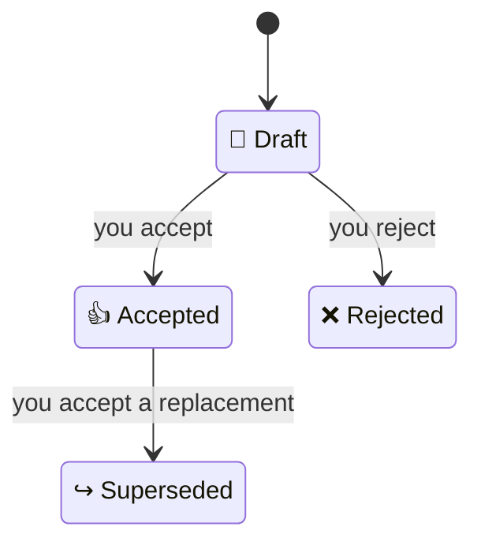

# `/adr`

`/adr` is the skill for recording technical decisions. It is one step of
[the SDLC](../../README.md); read that page first for the documents, skills and agents it
mentions.

## What an ADR is

An ADR (architecture decision record) records one technical decision and why it was made, such
as which database stores sessions or how two services talk to each other.[^nygard] The name says
"architecture", but any technical choice that is costly to reverse or that later work must
follow deserves one. What the product does is not an ADR: that belongs in the brief or a
[spec](spec.md), which say what, never how.

Each ADR holds exactly one decision, because a decision is replaced whole: if part of a record
could change while the rest stands, the two parts would have to be untangled later. Once
accepted, an ADR is never edited. When a decision changes, a new ADR supersedes the old one,
and the old one is kept, marked `↪️ Superseded`, so you can still see what was decided before and
why it changed.[^fowler]

Together, the accepted ADRs and the code are the system's design; there is no separate design
document to drift out of date.

## Where ADRs live

ADRs live in one flat folder, `docs/adrs/`, numbered in the order they were made and named by
what each decision is about, in three to five words:

```
docs/adrs/
  0001-session-data-storage.md       ↪️ Superseded
  0002-sending-email-to-customers.md 👍 Accepted
  0003-session-data-storage.md       👍 Accepted
  0004-caching-search-results.md     📝 Draft
```

Nothing is moved or deleted once decided, so each file's status says whether it still holds. A
replacement can share its subject with the ADR it replaces, as 0003 does, so the listing shows
where a decision changed. The title inside each file states the decision itself, such as "Store
sessions in Redis". ADRs refer to each other by number, never to specs, the brief or plans: those change
while an ADR does not, so a reference to them would go stale. Nor does an ADR refer to material
you handed over, such as a requirements document or notes, or to anything outside the lifecycle's
documents except a web page: it states what matters in its own words, and a plugin hook refuses
any other hyperlink or path.

## Anatomy

ADRs use the core of MADR (Markdown Architectural Decision Records), a widely used
template.[^madr]

| Part | Holds |
|---|---|
| `status:` and `date:` | `📝 Draft`, `👍 Accepted`, `❌ Rejected` or `↪️ Superseded`, and when it was written; `supersedes:` or `superseded-by:` name another ADR by number |
| Title | The decision, such as "Store sessions in Redis" |
| Context and Problem Statement | What forces a decision now |
| Considered Options | At least two options, and why each one not chosen was rejected |
| Decision Outcome | The option chosen and why |
| Consequences | What gets better and what gets worse because of it |
| Confirmation | What the decision applies to, such as "any code that stores or reads session data", and how to check the code follows it: by test, demonstration, inspection or analysis |
| Open questions | What only you can settle, such as an option nobody named or why one was rejected; empty before the ADR can be `👍 Accepted` |

Confirmation is what `/build` and [`/audit`](audit.md) use to check that the code still follows
each accepted decision. It names a concern rather than files, because the code may not exist yet and
an accepted ADR cannot be updated when files move.

## Statuses



- `📝 Draft`: being written and reviewed; `/adr` may change it freely.
- `👍 Accepted`: you have signed off the decision, and Open questions is empty. It is now fixed.
- `❌ Rejected`: you decided against it. It is kept, so the same idea is not proposed again
  unnoticed.
- `↪️ Superseded`: a newer accepted ADR replaced it. Its text stays as it was.

Only you can accept or reject an ADR. `/adr` asks you once the reviewed text is final, and
approval given earlier, or by another skill, does not count. A plugin hook refuses status changes
the lifecycle does not allow, a status without its emoji, accepting an ADR while Open questions is
not empty, and any edit to an ADR that is no longer `📝 Draft`, when Claude makes them with its
file-editing tools.

## Using `/adr`

Run `/adr` and say what you want: record a decision, accept or reject one, or replace one.

- **Drafts from the conversation.** If you have already talked the decision through, `/adr`
  drafts from that, and where you changed your mind, the latest word wins. It writes what is
  missing, such as an option nobody named or why one was rejected, into the ADR's Open questions,
  tells you how many there are and asks them one at a time. Your answer goes into the ADR and the
  question is removed.
- **One decision per record.** If the conversation holds several decisions, `/adr` says how many
  and writes one ADR for each.
- **Replacing a decision.** A new ADR names the one it replaces. The old one stays `👍 Accepted`
  until you accept the new one; then it becomes `↪️ Superseded`. If you reject the new one, the old one
  stands.
- **Uses spike records.** Given a finished [spike record](spike.md), `/adr` puts its measurements
  into the Considered Options in its own words. The ADR never refers to the record, which may be
  deleted.
- **Leaves specs alone.** `/adr` never edits or refers to a spec. If the decision answers a
  spec's open question, it tells you, and `/spec` removes the question the next time you run it.

## Review

Before you see an ADR, `/adr` has its reviewer agent check it against a short list of
pass-or-fail checks: one decision, a title that states it, real options with reasons, good and
bad consequences, a Confirmation that can really be carried out, references only to other ADRs, and
no clash with another ADR. The reviewer sees only the ADRs, not your conversation, so it judges
the page as a newcomer would. At the same time, a language checker reads it for words a newcomer
could not follow, by the [Plain words](../lifecycle.md#plain-words) rule: a term from your field
gets a footnote, and team shorthand is rewritten. `/adr` corrects what both find, once, and
has the corrections checked (see [Review process](../lifecycle.md#review-process)); then you get the ADR
with the reports.

[^nygard]: Michael Nygard, [Documenting Architecture Decisions](https://cognitect.com/blog/2011/11/15/documenting-architecture-decisions),
    2011. We take one decision per record, and keeping a reversed decision marked as superseded.
[^fowler]: Martin Fowler, [Architecture Decision Record](https://www.martinfowler.com/bliki/ArchitectureDecisionRecord.html).
    We take never reopening an accepted record, only superseding it, and numbered files that read
    well in a directory listing.
[^madr]: [MADR](https://adr.github.io/madr/), version 4.0. We take its core sections and its
    Confirmation section, and leave out decision drivers, per-option pros and cons, and the
    fields for who decided, was consulted or was informed.
