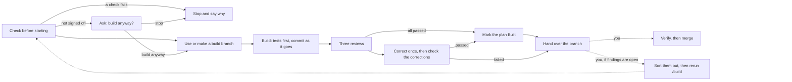

# `/build`

`/build` is the skill for building one plan. It is one step of [the lifecycle](../../README.md); read
that page first for the documents, skills and agents it mentions.

## What `/build` does

`/build` takes one plan that you have signed off, or that you choose to build before sign-off,
and writes the code and tests it describes on a
branch of its own, has the result reviewed, and hands the branch back to you.

## Your practices, and where `/build` stops

`/build` follows your project's practices: how to set up, build, test and run the product, how
branches and commits are named, and what must pass before work is merged. It reads them where
`/plan` does: the `## Practices` section of `AGENTS.md` and of `CLAUDE.md`, whichever have one, and
the files under `docs/practices/` they name, whether or not `CLAUDE.md` imports
`AGENTS.md`,[^memory] and its reviewer reads the same. The `/practices` skill, run whenever you want
to record or change a practice, asks you about them and records them under a `## Practices` heading
in `AGENTS.md`, with longer topics in `docs/practices/`, and makes sure `CLAUDE.md` imports
`AGENTS.md`. A choice between alternatives, such as which test framework to use, is an ADR
(architecture decision record) instead.

`/build` stops once it has handed the branch back. These steps stay with you, done the way your
practices say, because each needs a person:

- **Verifying:** starting the product and using it, the way a person would, to check it does
  what was asked. A build may run on a machine that cannot run the product, so this is a
  separate step. Claude Code's own `/verify` does it.[^verify]
- **Opening a pull request**, if you use them.
- **Merging** the branch into the main branch.

## Before it starts

Run `/agentic:build docs/plans/<plan>.md` as the first thing in a new session. Before it changes
anything, `/build` checks:

- **The session is fresh.** `/build` starts only in answer to the first message you send in a
  session, or the first after `/clear`, whether you type the command or ask in your own words. A
  long planning
  conversation is a poor start for building: Anthropic's own advice is to start a fresh session to
  build from a written spec,[^fresh] so the build begins with a clean context and a written
  definition of done. A plugin hook enforces this. The plugin has no reliable way to start a new
  session for you, so if the hook refuses, it gives you the two steps instead: run `/clear`, then
  send `/agentic:build docs/plans/<plan>.md`. In a Claude project, a new session is a new thread:
  open one and send that command as its first message, since the note that opens a thread does not
  count as your message. `/plan` gives you the same steps when you sign a plan off.
- **The plan exists and can be built.** A `✅ Built` plan is refused: a plan is built once. Every
  spec and ADR the plan names must exist, with a heading for each requirement it names, and none
  may be `❌ Rejected` or `↪️ Superseded`. These can't be overridden, since there would be nothing
  to build against.
- **The plan is signed off, or you choose to build anyway.** If the plan, or a spec or ADR it
  names, is `📝 Draft`, `/build` doesn't refuse. This is its last check, so a build you choose to
  go on with isn't then stopped by another. It lists what
  isn't signed off, including the plan's open questions, and asks "Build anyway, on the proposed
  answers?". Building before sign-off is your call: pick "Build anyway" and it builds each open
  question's proposed answer, or "Stop and settle them first" and it changes nothing. It never
  builds an unsigned plan without your answer, so an unattended run stops. The build's first
  commit says what wasn't signed off and how each open question was answered, so the record is in
  git, and the plan keeps its status.
- **Your practices, if any.** `/build` looks for the `## Practices` heading, and reads any file
  it names to read before a task like this. None is required:
  where a practice it needs is not recorded, such as how to run the tests, it works it out from
  your repository and carries on, and its report says what it assumed and suggests `/practices`
  to record it.
- **It is on a branch of its own, with nothing left uncommitted.** `/build` never builds on your
  repository's default branch. If you are on it, it makes a branch named as your practices say,
  or else after the plan. If you are already on another branch, it builds there, since some
  places that run Claude Code, such as its cloud sessions, choose the branch name for you. If anything is uncommitted, it stops, so your
  own work never gets mixed into the build. It ignores the stand-ins for `/dev/null` that Claude
  Code's sandbox puts in place of files it protects, such as `.bashrc`, on Linux. While it runs, a plugin hook refuses any commit or
  push to the default branch.
- **It has a remote.** The repository needs a remote named `origin` whose default branch git
  knows, which `git clone` sets up. `/security-review` compares the branch with that default
  branch, and the hand-over pushes to it. If it is missing, `/build` stops and names the command
  to run, such as `git remote set-head origin -a`; it never runs that itself, since it would
  change your repository.
- **The reviews can run.** Claude must be allowed to start `/code-review` and `/security-review`,
  which a setting can turn off. If either is not, `/build` stops and says which, so every build
  gets all three reviews.

Finally, it runs your tests once. Any test that already fails is noted for the report, and
`/build` does not try to fix it.

## Building

`/build` works through the requirements the plan names. For each one, it first writes tests from
the spec's examples and sees them fail, then writes the code that makes them pass. It then runs
your whole test suite and your linters, as your practices say, before moving on, so it notices at
once if the new code breaks something already built. It follows every `👍 Accepted` ADR the plan
names, and any other whose How we'll check section says it applies to the code being changed. It
commits as it goes, so the branch always holds the work so far.

Two rules hold throughout:

- **A test is never weakened to make the code pass.** `/build` changes a test only to make it
  check its example more closely, or to correct an expected value that plainly contradicts the
  spec, such as a typo, which its report then points out.
- **Two attempts, then stop.** If a requirement's tests still fail after two attempts, `/build`
  stops and hands over with the failure written down, rather than keep retrying an approach that fails.
  Anthropic gives the same advice: after two failed corrections, start again rather than try a
  third.[^twice]

If a build stops halfway, for whatever reason, start a new session on the same branch and run
`/build` with the same plan again. It reads what the branch already holds, compares it with the
plan and carries on.

### Decisions

A plan cannot foresee everything, so `/build` meets choices as it goes. It may make a choice itself
only if the choice would not need an ADR or a change to a spec. That means it raises any choice
that would:

- be a lasting choice between real alternatives, such as a library, a data format, or the shape
  of an interface: that is what an ADR is for, and only you accept ADRs;
- change what a user sees in a way the spec does not settle;
- be hard to undo later, such as a database schema, a public interface, or data already stored;
- stretch or contradict a spec, an ADR, or your practices.

To raise one, `/build` stops and hands over with the question written down. It never guesses. A
guess can carry a long build down the wrong path before anyone looks.[^assumption]

Every other choice, such as names, how the code is split up, which helper to use, the wording of
an error message or an exit code, `/build` makes itself and carries on, and the report lists
each one with its reason, so you can see what was decided for you.

`/build` leans towards correcting rather than asking. Anything plainly wrong, such as a crash
when no file name is given or an error reported in the wrong place, it corrects whether or not a
spec mentions it, with a test where it can, and lists each correction in its report so you can
add it to the spec. Stopping a build to ask about something obvious costs more than a small
overstep. It raises the case with you only when what should happen instead is a real product
choice that a reasonable person could want made differently.

## Review

When the code is written, three reviews check it side by side, each run by an agent that has not
seen the conversation:

- **Code:** Claude Code's own `/code-review`,[^codereview] looking for bugs. `/build` always runs
  it at `medium` effort, and always compares the whole branch with the main branch, so a rerun
  reviews the whole build, not just its latest commits.[^localreview] `/build` starts it inside an
  agent, as it does the security review, because some Claude Code versions run the skill inside
  the session rather than in a fresh agent of its own, and only an agent's report reliably reaches
  the plugin's hook that hands the reports to the correction check.
- **Security:** Claude Code's own `/security-review`, looking for security holes.
- **Plan:** the plugin's build reviewer. It checks that each requirement the plan names is built,
  with a test that checks each of its examples as the spec words it; that nothing unrequested was
  added; that the code follows the ADRs it must; and that no choice that should have been raised
  was made quietly. This is the review Anthropic suggests writing yourself: against your spec,
  reporting gaps that affect correctness and skipping style.[^specreview]

A reviewer asked to find problems will always find something, so the reviews pass once every bug
or security hole they report has been corrected. Findings about tidiness or style are listed in the
report but do not stop the plan being marked `✅ Built`.[^specreview]

`/build` corrects what the reviews find, once, and has the corrections checked, the same way
documents are reviewed (see [Review process](../lifecycle.md#review-process)). It then runs your
tests and linters again.

## Handing over

However the build ends, a small script commits the branch and pushes it to `origin`. It does
this, not Claude, and reports exactly what happened, including the branch name and any failure
to push. `/build` never opens a pull request and never merges.

The plan is set to `✅ Built` only when it was `🟢 Ready to build` and every review has passed. A
plan built before sign-off keeps its status: settle it and sign it off, then rerun `/build` on the
branch to mark it `✅ Built`. If the build stopped instead,
because the corrections failed their check, a requirement's tests still failed after two attempts,
or a choice needed raising, the plan keeps its status. Sort out what is open however suits
you: with Claude directly, by changing a spec or ADR, or by deciding a finding is wrong. Then rerun
`/build` on the branch. It resumes, reviews again, and marks the plan `✅ Built` once every review
passes. If you think a finding is wrong, say so when you rerun it.

It ends with a short reply: the outcome, the branch, whether the plan was marked `✅ Built`, any
question for you, and the full path of the build's report file. Where the app you run Claude Code
in can show you a file, the report opens there. The file is Markdown, kept outside your repository
in the plugin's data folder, under `reports/<repository>/`, named by date and plan; where that
folder can't be written, it goes in a private folder in your system's temporary folder
instead, until you delete it. It holds:

- what was built, or why it stopped and what is open;
- for a build before sign-off, what was not signed off and the answers it built on;
- the test and lint commands it ran, with their output, and any tests that were failing before it
  started;
- the decisions it made for you, each with its reason, and any defects it corrected that no spec
  mentions;
- what it corrected for each review;
- each review's report and the correction check's report, and the hand-over script's own report,
  copied in by the script word for word, so you read them exactly as they were given;
- what is left for you to check, and a reminder to verify the work before merging.

A build that refuses to start, such as on a plan that is already built, writes no file: its reply
says why.

## After a build

A `✅ Built` plan is frozen: it is never edited again, and you may delete it whenever nobody needs
it, since nothing refers to a plan. [`/audit`](audit.md) lists built plans you might delete. For
more work on the same requirements, write a new plan, or make small corrections by working with
Claude directly, which is the usual way to tidy up after a large build.

A spec's status does not change when it is built. It describes the document, not the software,
because a status about the software would stop being true, without anyone noticing, as the code
changes. To find out whether the software meets a spec, check the software against it.

[^verify]: Claude Code documentation, [Run and verify your app](https://code.claude.com/docs/en/skills#run-and-verify-your-app).
[^fresh]: Claude Code documentation, [Best practices: brainstorm with Claude first](https://code.claude.com/docs/en/best-practices#brainstorm-with-claude-first):
    "Once `SPEC.md` exists, start a fresh session to build from it, so the build begins with a
    clean context and a written definition of done."
[^codereview]: Claude Code documentation, [Best practices: give Claude a check to run](https://code.claude.com/docs/en/best-practices#give-claude-a-check-to-run):
    `/code-review` "reviews the diff in a fresh subagent that never saw your conversation".
[^specreview]: Claude Code documentation, [Best practices: review against your spec](https://code.claude.com/docs/en/best-practices#review-against-your-spec).
[^twice]: Claude Code documentation, [Best practices: steer the session](https://code.claude.com/docs/en/best-practices#steer-the-session):
    "after two failed corrections run `/clear` and write a better prompt instead of a third."
[^assumption]: Claude Code documentation, [Best practices: let Claude run without you](https://code.claude.com/docs/en/best-practices#let-claude-run-without-you):
    "you find out the next morning that it spent the whole night building on the wrong assumption."
[^localreview]: Claude Code documentation, [Review locally with /code-review](https://code.claude.com/docs/en/code-review-local).
[^memory]: Claude Code documentation, [How Claude remembers your project](https://code.claude.com/docs/en/memory#agents-md).
