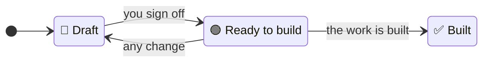

# `/plan`

`/plan` is the skill for planning a piece of work before it is built. It is one step of
[the SDLC](../../README.md); read that page first for the documents, skills and agents it
mentions.

## What a plan is

A plan says how one piece of work will build part of what the specs and ADRs (architecture
decision records) have already settled. It names the requirements the work delivers, the
decisions the code must follow, and how the work will be done. It is the bridge between the
documents that say what and why and the code that carries them out.

A plan is built once: when [`/build`](build.md) has built it and every review has passed, it is
marked `✅ Built` and kept, unchanged, as the record of what was built and how. Later work gets a
new plan. So a plan must never hold anything later work has to follow, such as a technical
decision. That belongs in an ADR.

Not every change needs a plan. Tidying code, a routine upgrade or a quick fix that builds no
requirement and follows no ADR is done straight from a conversation, with Claude's ordinary
planning if it helps. If you run `/plan` on such work, it tells you so. Should that work ever
contradict a spec, [`/audit`](audit.md) reports it.

## Where plans live

Plans live in one flat folder, `docs/plans/`, each named for the date it was first written and
its title:

```
docs/plans/
  2026-10-21-customs-hold-alerts.md          🟢 Ready to build
  2026-10-28-customs-hold-release.md         📝 Draft
```

The date shows when each plan was first written, so an old plan nobody built is easy to spot.
Several plans can be open at once, for work going on in parallel, but no two plans that are not
`✅ Built` may name the same requirement: if a plan already covers it, `/plan` offers to change that
plan instead.

A plan is the one document that refers to specs and ADRs, because once built it is a fixed
record of how they stood, so its references cannot go stale. Nothing refers to a plan.

## Anatomy

| Part | Holds |
|---|---|
| `status:` | `📝 Draft`, `🟢 Ready to build` or `✅ Built` |
| Title | The piece of work, in plain words |
| Specs | Each spec the work builds, as a link, with the requirements it delivers listed by name beneath it, as `Requirement: <name>` |
| ADRs | Each decision the code must follow, as a link, or "None." |
| Decisions | Each technical decision agreed with you that matters only to this work: what was decided and why, or "None." |
| Plan | How the work will be done, with headings and length to suit it |
| Open questions | What is still unsettled; "None." before `🟢 Ready to build` |

Everything except the Plan section has a fixed form, because it is checked: the Specs and ADRs
against the documents they name, and Decisions by you at sign-off. The Plan section is free in
shape: a small change to one requirement might be a single paragraph, a large feature might have sections for why,
approach, risks and steps. It follows this advice: start with why the work is being done and what
it leaves for later; give one recommended approach, not the alternatives; name the files that
matter and the existing code to reuse; and keep it short enough to scan but detailed enough to
carry out. It holds no code.

There is no section on testing. Each requirement in a spec already has a `Verified by:` line,
and each ADR a Confirmation, saying how to prove it, so the plan does not repeat them.

An example, for one requirement of a customs-holds spec:

```markdown
---
status: 🟢 Ready to build
---

# Customs hold release

## Specs

- [Customs hold alerts](../specs/customs-hold-alerts.spec.md)
  - Requirement: Release recorded

## ADRs

- [0003 Keep each shipment's status as a history of events](../adrs/0003-shipment-status-history.md)

## Decisions

- Show "cleared since <time>" beside "held since" on the container's page, rather than hiding
  the hold once released: the support team asked to see both when customers call.

## Plan

Releases reported by the customs broker are ignored today, so released containers stay in the
list of holds. A release becomes a "cleared" status event, recorded the same way holds are in
`src/broker/updates.py`, as the status history ADR requires. The list of holds already reads
each container's latest event, so it needs no change. Telling anyone about a release is left
for later; the spec doesn't ask for it.

1. Write the failing test from the spec's scenario.
2. Turn the broker's release message into a "cleared" event.
3. Show "cleared since" on the container's page.

## Open questions

- None.
```

## Statuses



- `📝 Draft`: being explored, discussed and written.
- `🟢 Ready to build`: you have signed off the plan as it stands. Any later change returns it to
  `📝 Draft`, for you to sign off again.
- `✅ Built`: `/build` built the work and every review passed. Only `/build`'s hand-over script
  sets it, and the hook refuses any change to a `✅ Built` plan.

A plugin hook refuses `🟢 Ready to build` unless Open questions is empty, every spec it names is
`👍 Accepted` and has each named requirement, every ADR it names is
`👍 Accepted`, and no other plan that is not `✅ Built` names the same requirement. If a
spec or ADR it names changes after you sign off, the plan is no longer settled: update it, and
sign it off again.

## Using `/plan`

Run `/sdlc:plan` and say what you want to build, such as "the release part of the customs hold
alerts spec". Type the `sdlc:` prefix: in the terminal, a bare `/plan` is Claude Code's own plan
mode, a different thing.

`/plan` never makes a technical decision for you. Its stages follow the order of Claude Code's
plan mode, which explores before it writes a plan for you to approve,[^planmode] and add a stage
for settling decisions with you (see [Why not Claude Code's plan
mode?](#why-not-claude-codes-plan-mode)):

1. **Keep to your practices.** It reads your recorded [practices](practices.md). If they say how
   work is split or how big one plan may be, such as "one plan per pull request", and the work you
   asked for is bigger, it says so and proposes splitting it into several plans, each one that
   can be built and reviewed on its own, and asks which to plan first. You can keep the work as
   one plan instead; the plan then says why under Decisions. With no such practice, it plans the
   work as you asked.[^batches]
2. **Explore.** It reads the specs, the ADRs and the code, changing nothing, using Claude
   Code's built-in Explore and Plan helper agents. This is where it finds the decisions: choices
   with a reasonable alternative that the specs, the ADRs and the existing code don't already
   settle. Following a pattern the code already uses is not a decision.
3. **Ask.** It tells you how many decisions there are and asks them one at a time, then waits
   for your answer. Each question proposes an answer and where it belongs, with a reason for
   both: in this plan, if it matters only to this work, or in an ADR, if later work will have to
   follow it. If an answer adds or removes a decision, it says so and gives the new count.
4. **Write.** Only when every decision is settled does it write the plan, with your decisions in
   it. A decision that needs an ADR goes under Open questions until you have recorded it with
   `/adr` and accepted it; `/plan` never writes ADRs itself.

When you are happy with the reviewed plan, tell `/plan` it is ready to build, and it sets the
status.

## Review

Before you see a plan, `/plan` has its reviewer agent check it against a short list of pass-or-fail
checks: the fixed sections are there; every named requirement exists in its spec; the specs and
ADRs are settled; no other plan that is not `✅ Built` names the same requirement; a plan that
is `🟢 Ready to build` has no open questions; only specs and ADRs are referred to; the Plan section holds
no code; no decision is made in the Plan section that is missing from Decisions or ADRs; and the plan
keeps to any size or way of splitting work your practices record, or says why not. The
reviewer may suggest how to improve the Plan section itself, but those suggestions never hold a
plan back. The reviewer sees only the plan, the documents it names and your practices, not your conversation, so it
judges the page as a newcomer would. At the same time, a language checker reads it for words a
newcomer could not follow, by the [Plain words](../lifecycle.md#plain-words) rule. `/plan`
corrects what both find, once, and has the
corrections checked (see [Review process](../lifecycle.md#review-process)); then you get the plan
with the reports.

## Why not Claude Code's plan mode?

Claude Code has its own plan mode, in which Claude explores, writes a plan and asks you to
approve it before editing anything.[^planmode] `/plan` works the same way, exploring with the
same Explore and Plan helper agents before it writes, but does not run inside plan mode, for two
reasons found by trying it with Claude Code 2.1.312:

- Plan mode is not available in the non-interactive sessions the plugin's tests use, so a skill
  built on it could not be tested.
- Approving a plan in plan mode starts the building straight away, while a lifecycle plan is
  signed off, kept and built later, possibly by someone else.

[^planmode]: Claude Code documentation, [Analyze before you edit with plan mode](https://code.claude.com/docs/en/permission-modes).
    We take its order of work: explore and design with helper agents first, then write the plan for
    you to approve.

[^batches]: Small plans follow DORA's research on [working in small
    batches](https://dora.dev/capabilities/working-in-small-batches/), which finds that small
    batches predict better delivery, matter more when AI writes the code because "large changes
    are difficult to review, test, and integrate safely", and that "any batch of code that takes
    longer than a week to complete and check is too big".
