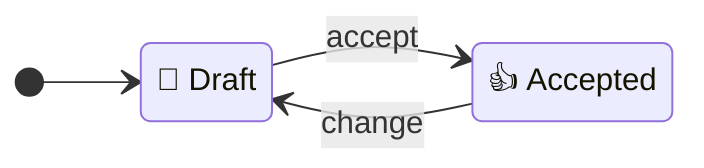

# `/spec`

`/spec` is the skill for writing and changing specs. It is one step of
[the SDLC](../../README.md); read that page first for the documents, skills and agents it
mentions.

## What a spec is

A spec describes one capability of the product: something a user or another system can do
with it, such as resetting a password. There is one spec per capability, and it describes the
system as it should behave now. It says
*what* the system does, never *how* it is built: a technical choice that comes up while shaping
a spec belongs in a [spike](spike.md) or an [ADR](adr.md).[^openspec]
A spec is edited in place on a branch, and git is its history.

## Anatomy

| Section | Holds |
|---|---|
| Problem | Who is stuck, and what happens today, told as one specific story[^shapeup] |
| Goal | What changes for them when this is built |
| Scope | What is in, and what is explicitly out[^shapeup] |
| Requirements | The behaviour, one requirement at a time |
| Constraints | Hard limits the behaviour must respect |
| Open questions | Unknowns still to answer; empty before the spec can be `👍 Accepted` |

These sections are the minimum. A spec can have more, such as "Security" or "Privacy", when you
ask `/spec` for them; they go before Open questions and are held to the same checks, and
each requirement stays under Requirements.

Each requirement has a name, one rule and some scenarios. The rule is a single sentence in
EARS, a small set of sentence patterns for requirements such as "IF ..., THEN the system SHALL
...", where SHALL means the requirement is mandatory.[^ears][^rfc2119] The scenarios use
Gherkin's Given/When/Then, the format behaviour-driven development uses to describe one
example.[^gherkin] The rule covers every case; each scenario pins down one concrete case, such
as a boundary or an example with real values, and never has an outcome that no rule in the spec
states. A scenario that only restates the rule is left out.[^openspec] *Verified by* names the
method that shows the requirement holds: usually a test, otherwise a demonstration, inspection
or analysis.[^nasa]

```markdown
### Requirement: Reset links expire

WHEN a person opens a reset link, the system SHALL let them set a new password if the link is
at most 24 hours old, and reject the link otherwise.

#### Scenario: Link used just before expiry
- GIVEN a reset link issued 23 hours 59 minutes ago
- WHEN the user opens it
- THEN the system lets them set a new password

#### Scenario: Link used just after expiry
- GIVEN a reset link issued 24 hours 1 minute ago
- WHEN the user opens it
- THEN the system rejects the link

Verified by: unit tests for both scenarios.
```

## Lifecycle



- `📝 Draft`: being shaped.
- `👍 Accepted`: you have accepted the text. You have said it is done, Open questions is empty,
  the review (below) has passed with no decision left for you, and you have seen the text as it
  stands. If `/spec` changes anything after you asked, even a small fix you allowed in advance, it
  shows you the change and waits for your reply before setting `👍 Accepted`.

The status describes the document, not the software, so building the software the spec describes does not change it: a
status about the software would stop being true, without anyone noticing, as the code changes. To
find out whether the software meets a spec, check the software against it.

Changing a `👍 Accepted` spec returns it to `📝 Draft`. An older spec whose status is
`🟢 Ready to build` or `✅ Built`, which specs no longer use, must be set back to `📝 Draft` before
it can be accepted. A capability that is no longer wanted has
its spec deleted; git keeps the history.[^openspec]

Two things keep specs in this shape, and a third is planned:

- **Review.** Before you see a spec, `/spec` has its reviewer agent check it against a short
  list of pass-or-fail checks: the sections are all there, each requirement has one EARS rule,
  its scenarios add real cases, Verified by names a method, and the spec refers to no other spec,
  nor the brief, an ADR or a plan, nor any material outside the lifecycle's documents except a web
  page, such as a requirements document you handed over, by hyperlink, path or title, since those
  can change without the spec being touched and the reference would go stale. A plugin hook also
  refuses any such hyperlink or path. At the same time, a language checker
  reads it for words a newcomer could not follow, by the
  [Plain words](../lifecycle.md#plain-words) rule: a term from your field gets a footnote, and
  team shorthand is rewritten. `/spec` corrects what both find, once, and has the corrections checked (see [Review process](../lifecycle.md#review-process));
  then you get the spec with the reports.
- **Status.** A hook checks each edit Claude makes to a spec with its file-editing tools and
  refuses one the lifecycle does not allow: a new spec that is not `📝 Draft`,
  `👍 Accepted` while Open questions is not empty or in the same edit as a change to the text, a
  change to a `👍 Accepted` spec that does not return it to `📝 Draft`, any other status, or a
  status without its emoji. Plans get the same kind of check; see
  [`/plan`](plan.md).
- **Audit.** [`/audit`](audit.md) finds specs and code that no longer agree, and specs left
  wrong by a hand edit, which the hook does not see.

## Using `/spec`

Run `/spec` and tell it what you want to do:

- **New:** start a spec for a capability. `/spec` first checks whether an existing spec already
  covers it.
- **Change:** edit a spec in place, including answering an open question, for example with the
  answer from a finished [spike record](spike.md). The spec states the spike's evidence in its own
  words and never refers to the record, which may be deleted.
- **Accept:** mark a spec `👍 Accepted`.

When the spec has open questions, `/spec` tells you how many there are and asks them one at a
time; the rest wait in the spec's Open questions section. If you say you would rather not
answer now, it leaves them there.

## Where specs live

`docs/specs/<capability>.spec.md`, named for the capability. Specs start flat; when there are
enough to need it, group them into folders of your choosing. The plugin finds specs anywhere
under `docs/specs/` and gives folders no meaning. Move a spec with `git mv`, which keeps its
status; the hook would see a spec written in a new place as a new spec and require `📝 Draft`.

[^ears]: Mavin, Wilkinson, Harwood and Novak, "Easy Approach to Requirements Syntax (EARS)",
    17th IEEE International Requirements Engineering Conference, 2009,
    [doi:10.1109/RE.2009.9](https://doi.org/10.1109/RE.2009.9); summary on
    [Wikipedia](https://en.wikipedia.org/wiki/Easy_Approach_to_Requirements_Syntax). We take its
    sentence patterns for each requirement's rule.
[^gherkin]: Cucumber, [Gherkin reference](https://cucumber.io/docs/gherkin/reference/). We take
    Given/When/Then for scenarios, without requiring a test runner.
[^openspec]: Fission AI, [OpenSpec: Writing Good Specs](https://github.com/Fission-AI/OpenSpec/blob/main/docs/writing-specs.md).
    We take its rule that a spec describes behaviour, not code; its requirement and scenario
    headings; its rule that a scenario must exercise its requirement rather than restate it;
    and deleting a capability's spec when it is retired. We leave out its change folders and
    delta specs.
[^rfc2119]: Bradner, [RFC 2119: Key words for use in RFCs to Indicate Requirement Levels](https://www.rfc-editor.org/info/rfc2119/),
    1997.
[^nasa]: NASA, [Systems Engineering Handbook, 5.3 Product Verification](https://www.nasa.gov/reference/5-3-product-verification/).
    We take its four verification methods: test, demonstration, inspection and analysis.
[^shapeup]: Ryan Singer, [Shape Up, chapter 6: Write the Pitch](https://basecamp.com/shapeup/1.5-chapter-06),
    Basecamp, 2019. We take its Problem, told as one specific story, and its no-gos, things
    explicitly excluded, which become our out of scope.
